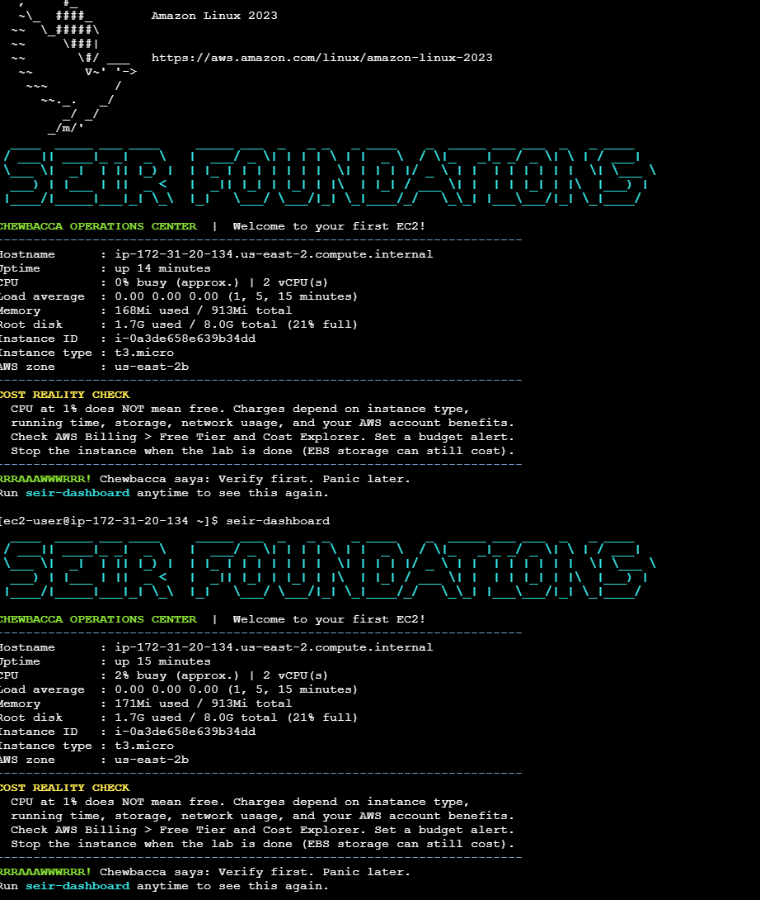
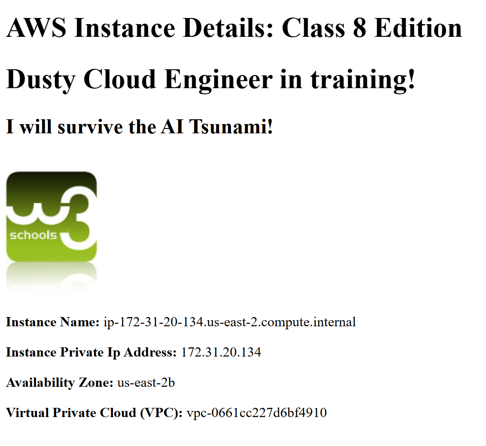
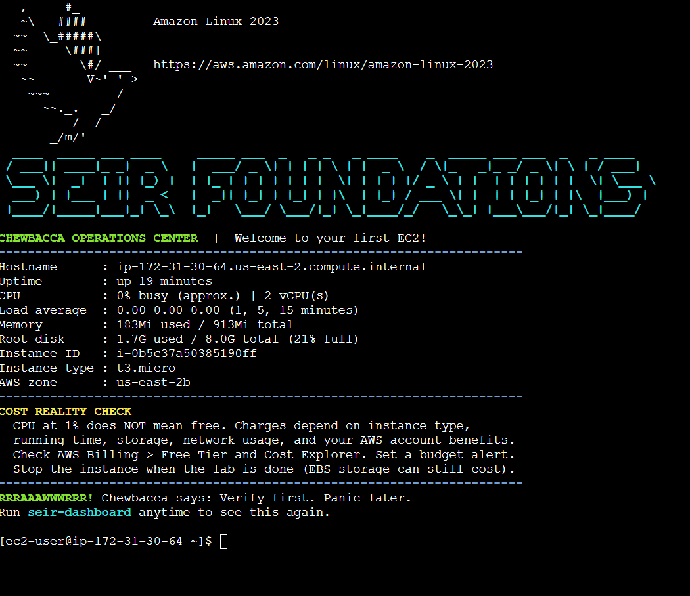
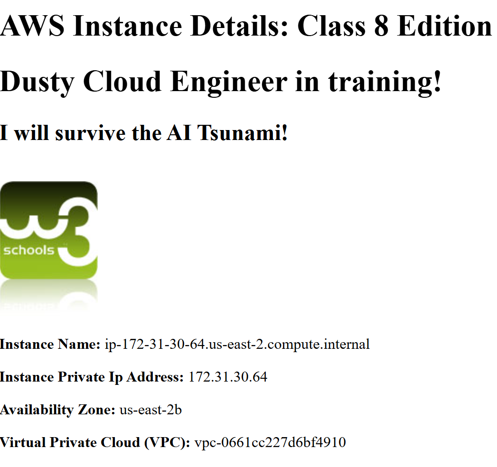
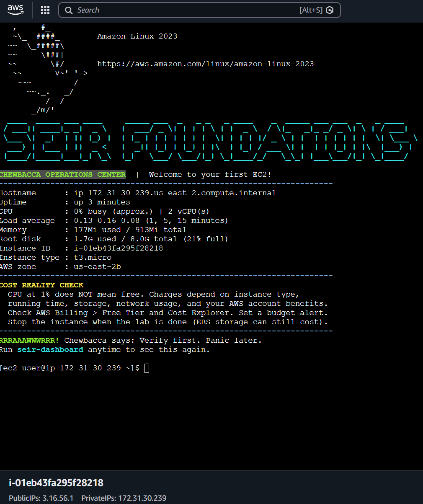
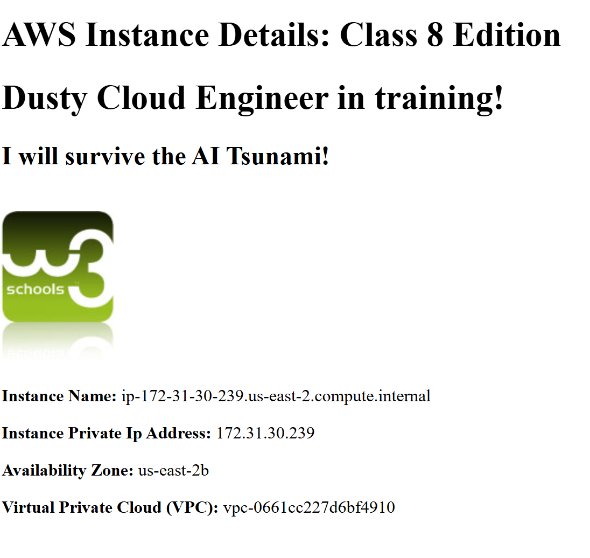

# SEIR Foundations — Module 1, Lab 0

## Objective

Deploy, connect to, and verify three Amazon EC2 instances using a reusable launch template and an automated Bash User Data script. Demonstrate that the same configuration can be used repeatedly to provision working Linux servers with different public IPv4 addresses.

## AWS Configuration

- **AWS Region:** US East (Ohio) — us-east-2
- **Operating System:** Amazon Linux 2023
- **Instance Type:** t3.micro
- **Launch Template:** seir-foundations-lab0
- **Security Group:** seir-foundations-sg
- **Connection Method:** EC2 Instance Connect
- **Automation:** Bash User Data script
- **Web Server:** Apache HTTP Server
- **Monitoring Dashboard:** Chewbacca Operations Center

## Deployment Results

| Deployment | Public IPv4 Address | Connection Method | Dashboard | Instance Terminated |
|---|---|---|---|---|
| 1 | 18.223.184.125 | EC2 Instance Connect | Verified | Yes |
| 2 | 18.220.237.56 | EC2 Instance Connect | Verified | Yes |
| 3 | 3.16.56.1 | EC2 Instance Connect | Verified | Yes |

All three deployments used the saved launch template and produced distinct public IPv4 addresses.

## Deployment 1

I launched my first EC2 instance from the saved launch template and waited for AWS to complete its status checks. After recording the public IPv4 address, I attempted to connect through EC2 Instance Connect.

The initial connection failed because the security group needed an additional SSH inbound rule allowing the AWS EC2 Instance Connect service. After adding the appropriate AWS-managed prefix list for the Ohio Region, I connected successfully.

The Chewbacca Operations Center dashboard displayed the instance's CPU, memory, disk usage, uptime, and instance details. I also confirmed that the Apache webpage loaded successfully.

**Apache Web Server Verification**

## Deployment 2

I launched a second EC2 instance using the same launch template. AWS assigned it a different public IPv4 address.

I connected through EC2 Instance Connect and verified that the Chewbacca Operations Center dashboard appeared. I also opened the instance's public IPv4 address in a browser and confirmed that the Apache webpage was working.

This deployment demonstrated that the same launch template and User Data script could produce another functioning server without repeating the manual software installation.

**Apache Web Server Verification**

## Deployment 3

I launched a third EC2 instance from the same template and recorded its new public IPv4 address.

After waiting for the instance to become ready, I connected using EC2 Instance Connect and verified the Chewbacca Operations Center dashboard. I saved the final dashboard screenshot and terminated the instance after completing the lab.

**Apache Web Server Verification**

## Understanding the Dashboard

The Chewbacca Operations Center dashboard provided several important Linux system measurements:

- **CPU usage:** Shows how much processing capacity the server is using.
- **Memory usage:** Shows how much RAM is currently in use compared with the total available.
- **Disk usage:** Shows how much storage space is occupied and how much remains.
- **Uptime:** Shows how long the instance has been running since its last startup.
- **Instance ID:** Identifies the specific EC2 virtual machine.
- **Instance type:** Identifies the AWS compute configuration, such as t3.micro.

These measurements help cloud engineers understand server health, resource utilization, and potential performance problems.

## Troubleshooting

During my first deployment, EC2 Instance Connect initially failed.

I investigated the instance's security group and learned that restricting SSH to my personal IP address does not necessarily allow browser-based EC2 Instance Connect traffic.

I resolved the problem by adding an inbound SSH rule that allowed the appropriate AWS-managed EC2 Instance Connect prefix list for us-east-2.

After updating the security group, I successfully connected to the instance.

## What I Learned

This lab introduced me to the relationship between EC2 instances, launch templates, security groups, and automated provisioning.

I learned that a launch template provides a reusable configuration, while each EC2 instance is a separate virtual server with its own instance ID and public IPv4 address.

I also learned how to connect to Linux servers, troubleshoot SSH access, examine resource utilization, and verify that an Apache web server is functioning.

Repeating the deployment process made it easier to navigate the AWS Console, recognize when an instance was ready, locate its public IPv4 address, and connect through EC2 Instance Connect.

Most importantly, I learned that cloud engineering involves not only launching infrastructure but also verifying, troubleshooting, documenting, and cleaning it up.

## Cleanup

All three EC2 instances were terminated after the lab to avoid unnecessary running costs.

The reusable `seir-foundations-lab0` launch template was preserved for future assignments.

## Conclusion

I successfully completed three separate EC2 deployments using a reusable AWS launch template and automated User Data script. Each deployment produced a functioning Linux dashboard, and all three instances had distinct public IPv4 addresses.